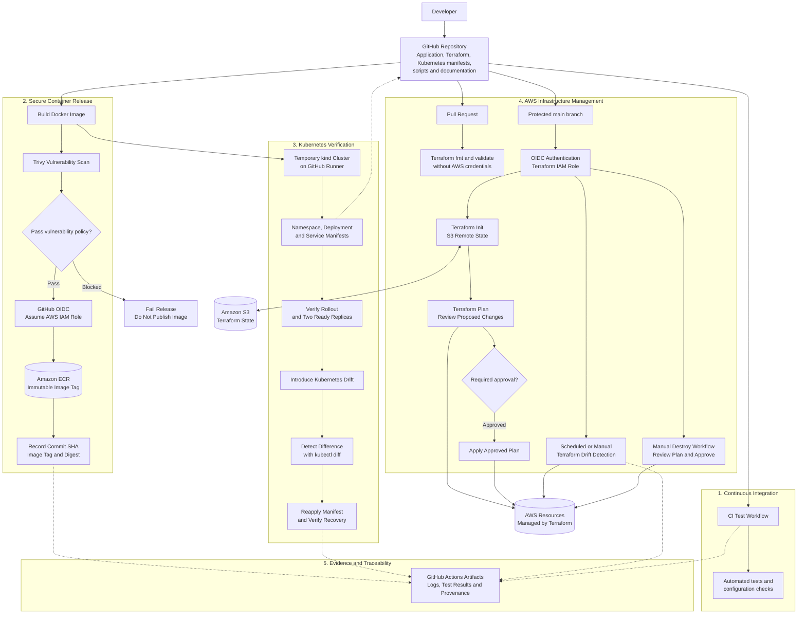

# Web-Slinger Architecture

## Overview

Web-Slinger combines application testing, container security, AWS infrastructure management, and Kubernetes deployment verification through GitHub Actions.

The architecture has four main areas:

1. Continuous integration for application and configuration checks.
2. Secure container release from source code to Amazon ECR.
3. Kubernetes deployment verification and drift recovery in a temporary kind cluster.
4. Terraform-based AWS infrastructure management and drift detection.

## Architecture diagram

## Component responsibilities

| Component | Responsibility |
|---|---|
| GitHub repository | Source of truth for application code, Terraform configuration, Kubernetes manifests, and workflows. |
| CI workflow | Runs the configured application and configuration checks. |
| Docker | Packages the application into a container image. |
| Trivy | Checks the built image for known vulnerabilities. |
| GitHub OIDC | Allows authorised workflows to obtain temporary AWS credentials without storing long-lived AWS keys in the repository. |
| Amazon ECR | Stores published container images and their immutable tags. |
| Image provenance | Records the source commit, image tag, and image digest. |
| kind and Kubernetes | Run deployment and drift-recovery tests on the GitHub Actions runner. |
| Terraform | Plans and manages AWS infrastructure and detects differences from the declared configuration. |
| Amazon S3 | Stores the remote Terraform state. |
| GitHub Actions artifacts | Preserve selected test evidence and plan-review files for a limited retention period. |

## Container release sequence

The release workflow builds the image locally, scans it with Trivy, and blocks publication if the configured vulnerability policy fails. Once the scan passes, the workflow authenticates to AWS, publishes the image to ECR, and records its digest and source commit.

The Kubernetes test loads the same locally scanned image into kind. This validates the scanned build rather than building a different image for the test.

## Infrastructure workflow

Pull requests should run Terraform formatting and validation without AWS credentials. AWS-backed planning and application should be restricted to the trusted branch and protected environment, with review of the proposed changes before approval.

The Terraform drift workflow compares the declared configuration with the infrastructure and state observed by Terraform. A controlled exercise can then demonstrate detection, recovery, and verification.

## Deployment boundary

The Kubernetes cluster created by the release workflow is temporary. It exists on the GitHub Actions runner for automated testing and is removed when the runner is discarded.

The Terraform workflows manage AWS resources defined by the project's Terraform configuration. They do not automatically make the temporary kind cluster a persistent AWS-hosted Kubernetes service.

## Security boundaries

- IAM roles should use least-privilege permissions.
- OIDC trust policies must match the authorised repository, branch, or GitHub environment identity.
- Pull requests from untrusted contexts must not receive AWS credentials.
- Vulnerability exceptions should be documented and reviewed.
- Terraform apply and destroy operations must use appropriate approval and review controls.
- Terraform state, destruction plans, and deployment evidence may contain sensitive information and should have appropriate access and retention controls.
